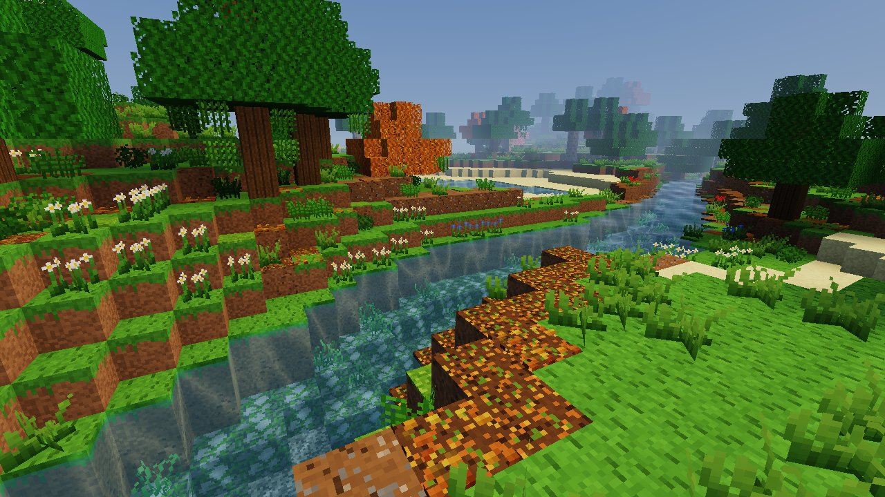
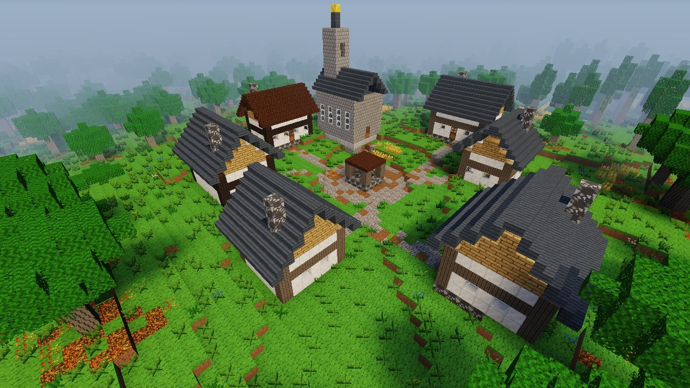
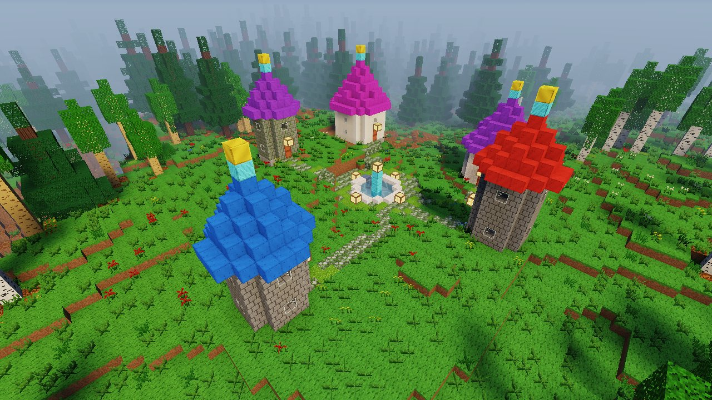
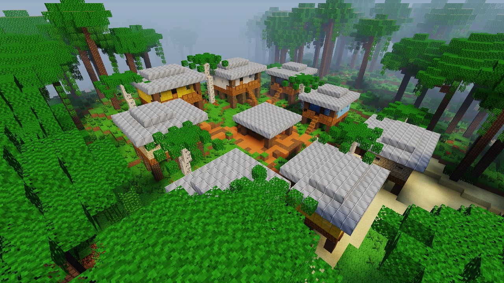

# Block Builder

A small voxel building sandbox for Android, written in plain Java with OpenGL ES 2.0 (no libraries).



| Medieval | Fantasy | Darwin |
| --- | --- | --- |
|  |  |  |

**Download:** [`apk/BlockBuilder.apk`](apk/BlockBuilder.apk). Open it on an Android 5.0+ phone and allow
"install unknown apps" when asked.

## Features
- Near-infinite worlds (20 million blocks across) streamed in chunks around you, 96 blocks tall;
  only chunks you change are saved
- 55 biomes: one for every wood species (oak woodlands, birch groves, spruce taiga, redwood forests,
  mahogany jungles, cypress swamps, savannas...) plus mixed ones (Mixed Woodland, Temperate and
  Tropical Rainforest, Autumn Hills, Blossom Valley, Shrubland, Meadow, Snowy Peaks, Tropical Marsh)
- Tree shapes per family: broad, round, slender, cone, pine, giant, tropical, savanna, cedar,
  cypress, palm and shrubs
- Themed villages: Medieval (timber-frame cottages, church, well), Fantasy (cone-roofed towers,
  crystal fountain) and Darwin (raised tropical houses on stilts with verandas and metal roofs)
- Title screen to create, play and delete multiple worlds (normal or flat terrain, optional seed)
- 128 × 128 × 64 world with procedural hills, mountains with snow, beaches, lakes and trees
- Blocks in six tabs: Natural, Wood, Stone, Building, Minerals and Colors (16 colors),
  including ores, three kinds of wood, bookshelves, crates, roof tiles, metal and a glow lamp
- 46 real-world wood species (hardwoods such as White Oak, Black Walnut, Teak and Zebrano, and
  softwoods such as Scots Pine, Douglas Fir and Redwood), each with its own log, planks, stairs,
  slab, door and trapdoor
- 26 real-world stones (igneous, sedimentary, metamorphic and other decorative stones such as
  Portland Stone, Travertine, Gneiss, Onyx and Tufa), each with its own block, stairs and slab
- Stairs and slabs face the way you look and go upside-down / on top when you tap the upper half of a
  block; doors and trapdoors open and close when tapped in Build mode; two slabs merge into planks
- Lush worlds: winding rivers with cobble beds and earthy banks, grass tufts, ferns, bushes,
  wildflowers, golden wheat fields, forest floor and leaf litter under trees, hanging vines and seagrass
- A Plants tab with 13 plants and ground covers (moss carpet, leaf litter, moss block)
- Worlds generate ores underground, gravel and clay lake beds, and four kinds of trees
- Golden-hour lighting: warm, low directional sunlight with cast shadows (soft through leaves), cool sky
  light, ambient occlusion, filmic tone mapping, a gradient sky with a sun, and atmospheric haze
- Clear water with animated ripples, sky reflections (Fresnel), sun glints and moving caustics on the
  riverbed; murky underwater view
- Leaves and plants sway in the wind
- Mipmapped textures (no shimmering in the distance) and natural colour variation in plants
- Walking with auto-jump, swimming, and a fly mode
- Worlds are saved automatically when you go back to the menu or leave the app

## Controls
| Action | Touch |
| --- | --- |
| Move | Drag on the left side of the screen (a joystick appears) |
| Look | Drag on the right side |
| Build / break | Tap on the right side (the BUILD/BREAK button switches modes) |
| Break quickly | Hold a finger still on the right side |
| Jump / swim up | JUMP button |
| Fly | FLY button (then UP / DOWN) |
| Pick blocks | Tap a hotbar slot, or tap **+** to choose any block (by tab) for the selected slot. In the Wood and Stone tabs, pick a wood or stone to see its pieces; drag to scroll |
| Open / close doors | Tap a door or trapdoor in Build mode |
| Back to the world list | MENU button (top-left) or the phone's Back button |

## Building from source
Requires JDK 17+ and the Android SDK (platform 34, build-tools 34).

```sh
echo "sdk.dir=/path/to/android-sdk" > local.properties
./gradlew assembleRelease
# output: app/build/outputs/apk/release/app-release.apk
```

The release build is signed with the local debug key so it can be sideloaded directly.
